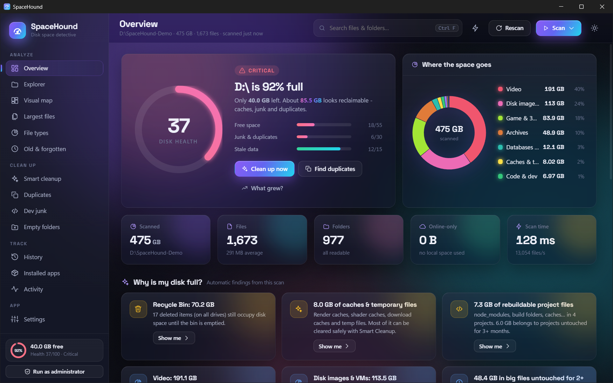
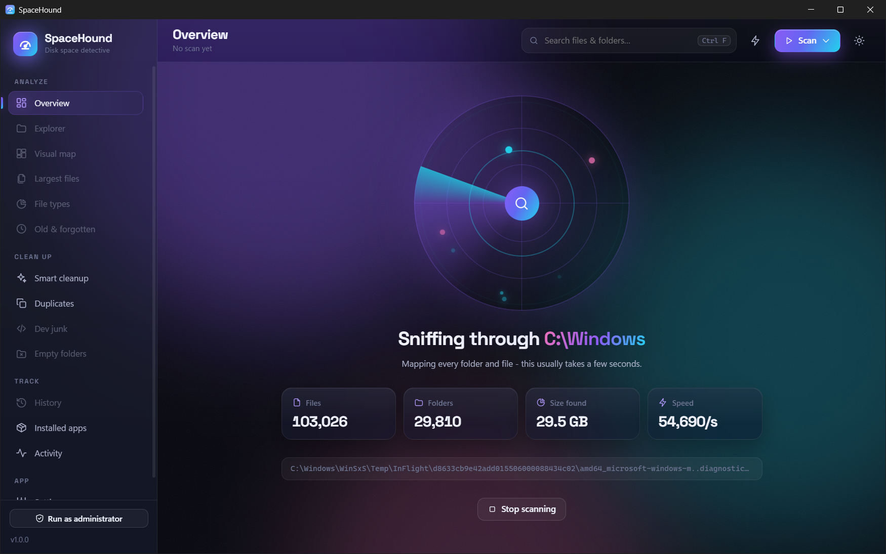
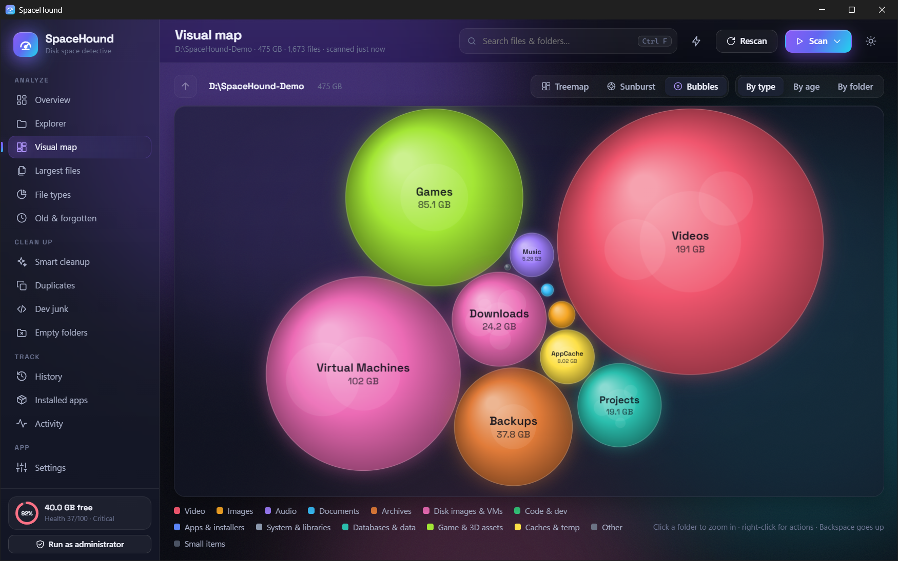
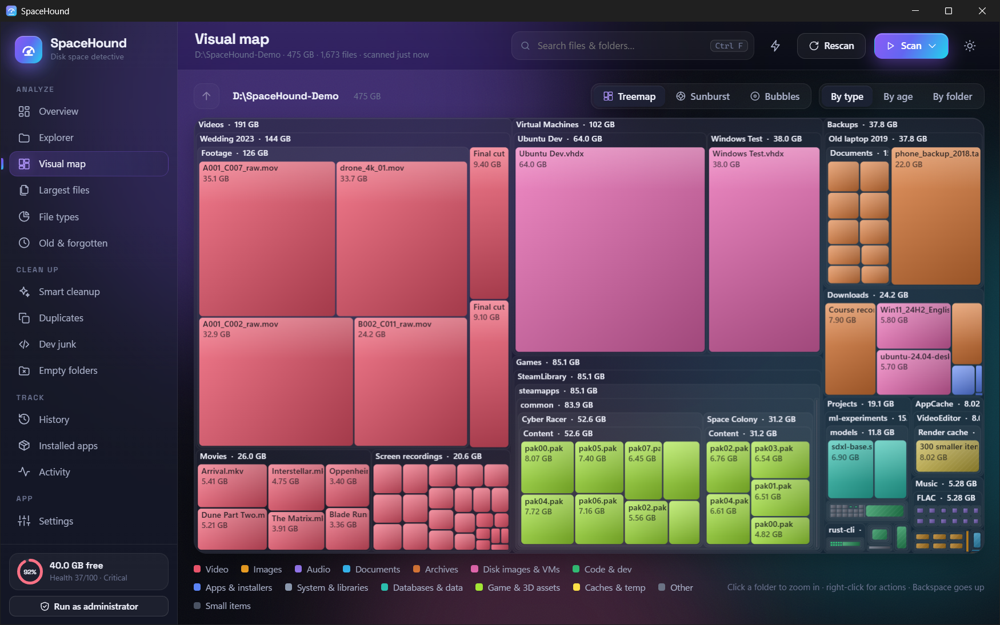
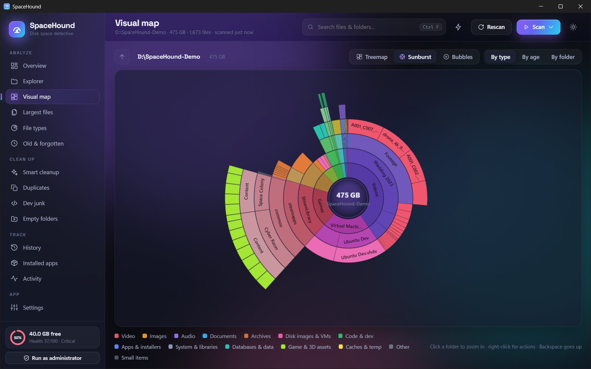
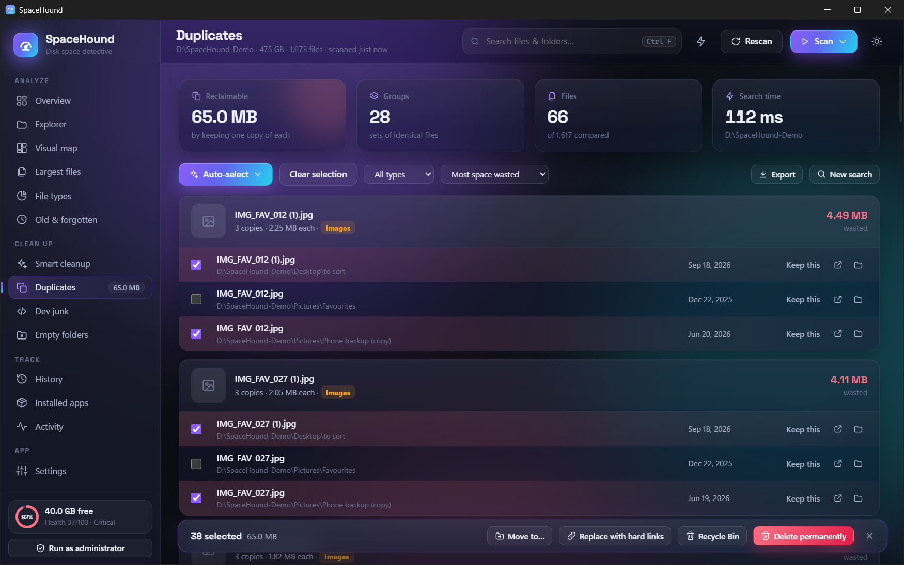
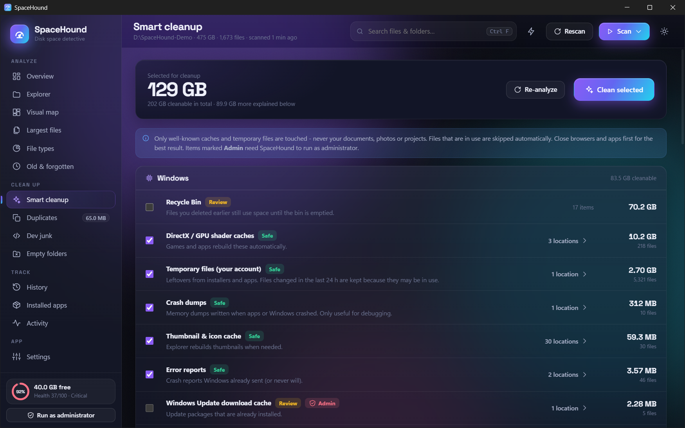
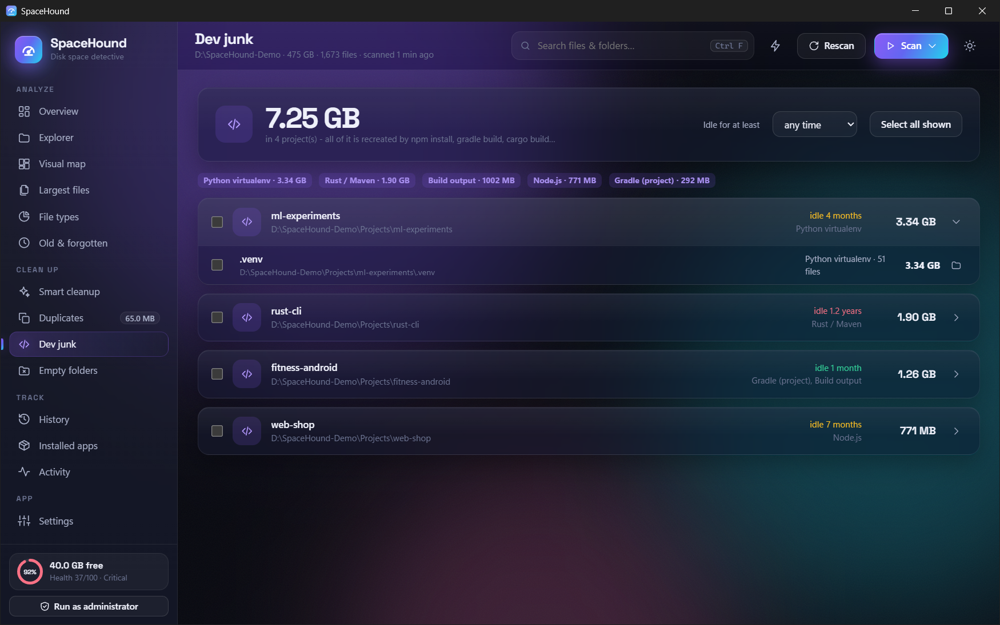
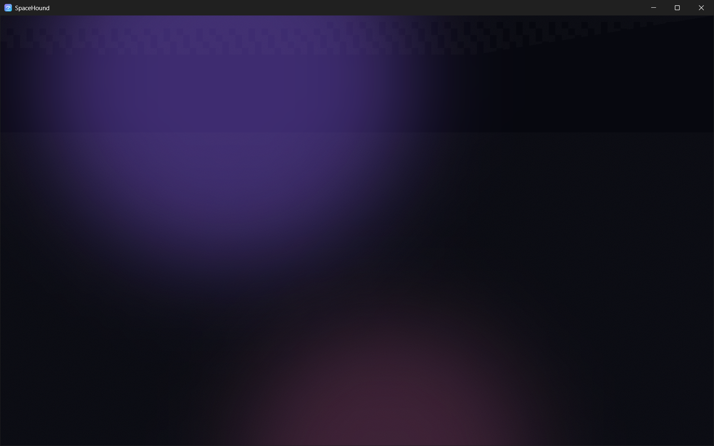

<p align="center">
  
</p>

<h1 align="center">SpaceHound</h1>

<p align="center">
  <b>Find out what's eating your disk - and get the space back, safely.</b><br>
  A fast, beautiful disk space analyzer & cleaner for Windows.
</p>

<p align="center">
  
  
  
</p>



Your 1 TB drive is suddenly full and you have no idea why? SpaceHound scans the whole drive in seconds,
**explains in plain language where the space went**, and gives you safe one-click ways to reclaim it:
duplicates, caches, forgotten project builds, old installers, giant backups you forgot about.

## Features

**Understand**
- **Fast parallel scanner** - a full 1 TB SSD with ~800 000 files takes about 15 s and ~130 MB of RAM,
  shown live on a **sonar screen** while the hound sniffs through your drive.
- **Disk Health score** - one 0-100 number from free space, reclaimable junk and stale data, with a plain verdict
  (*Healthy → Critical*) and one-click fixes.
- **"Why is my disk full?" insights** - automatic findings such as *"126 GB of caches & temporary files"*,
  *"Downloads holds 60 GB, 40 GB untouched for 6+ months"*, *"60 GB on C:\ is invisible to a normal scan"* (restore points),
  *"Up to 50 GB may be duplicates"*, hibernation file, Android emulators, Recycle Bin…
- **Visual map** - interactive **treemap**, **sunburst** and **bubbles**, coloured by file type, by age or by top-level folder. Click to zoom.
- **Explorer** - drill down folder by folder with size bars, a per-folder type breakdown and the biggest files inside.
- **Largest files** - filter by type, size, age, name or wildcard (`*.iso`), export to CSV.
- **File types** - every category and extension with counts, totals and averages.
- **Old & forgotten** - big files nobody touched for years, and whole folders that went stale.
- **History** - every scan saves a lightweight snapshot, so SpaceHound can show **exactly which folders grew** since last week.
- **Installed apps** - real on-disk size of every installed program, and it spots **old versions installed side by side** (e.g. Premiere Pro 2025 *and* 2026).

**Clean up**
- **Smart cleanup** - ~45 rules for regenerable junk: Windows temp, error reports, crash dumps, update & delivery-optimization caches,
  shader caches, Chrome / Edge / Firefox / Brave caches, Discord, Spotify, Teams, Steam, Adobe disk & media caches,
  DaVinci Resolve, VS Code, JetBrains / Android Studio caches and **old IDE versions**, Gradle, npm/Yarn/pnpm, pip/uv/Poetry, Conda,
  NuGet, Maven, Cargo, Go, Flutter… plus explained-only items (hibernation file, WinSxS, Windows.old, WSL/Docker disks, Android emulators)
  with the exact command to shrink them.
- **Duplicate finder** - size → first/last 64 KB → full BLAKE2 hash, so only byte-identical files are reported.
  Hard links are recognised. Smart auto-select (keep newest / oldest / shortest path / outside Downloads / inside a folder),
  image previews, and three ways to reclaim: Recycle Bin, permanent delete, or **replace duplicates with hard links** (frees the
  space, every path keeps working).
- **Dev junk** - finds `node_modules`, Gradle/Android `build` & `.gradle`, Rust/Maven `target`, Python `.venv` & caches, .NET `bin/obj`,
  Flutter `.dart_tool`, Unity `Library`, Unreal `Intermediate`, CMake/CLion builds… grouped per project and sorted by how long the project has been idle.
- **Empty folders**, **move to another drive**, **rescan a single folder**, **CSV / HTML reports**.

**Feels great**
- "Deep space" design: aurora background, glass panels, Space Grotesk display type, dark & light themes.
- **Command palette** (<kbd>Ctrl</kbd>+<kbd>K</kbd>) to jump anywhere, start scans or run actions from the keyboard.
- Animated counters, staggered cards, a glowing health gauge - and confetti when you win space back.

**Safe by design**
- Deletes go to the **Recycle Bin by default**; permanent delete always asks first.
- Windows, Program Files, drive roots, your main user folders and system files are **protected** - SpaceHound refuses to delete them.
  Add your own protected folders in Settings.
- Junctions and symlinks are never followed, OneDrive "online-only" files are never downloaded or counted as local.
- Duplicate deletion refuses to remove **every** copy of a file.
- Activity log of everything you deleted, moved or hard-linked, with a running "space freed" counter.

## Screenshots

| Live scan | Bubbles |
|---|---|
|  |  |
| **Treemap** | **Sunburst** |
|  |  |
| **Duplicates** | **Smart cleanup** |
|  |  |
| **Dev junk** | **Explorer** |
|  |  |

<sub>Screenshots use a generated demo folder (`scripts/make_demo.py`), not real personal data.</sub>

## Download

Grab **`SpaceHound.exe`** from the [Releases](https://github.com/veneficus7/SpaceHound/releases/latest) page - a single portable file, no installer.
It needs the Microsoft Edge **WebView2** runtime, which is already part of Windows 11 (and most Windows 10 installs).

> Tip: for a complete picture of system folders, click **Run as administrator** in the sidebar.

## Run from source

```powershell
git clone https://github.com/veneficus7/SpaceHound.git
cd SpaceHound
py -3.12 -m venv .venv
.venv\Scripts\pip install -r requirements.txt
.venv\Scripts\python -m spacehound            # desktop window
.venv\Scripts\python -m spacehound D:\        # open and scan D:\ right away
.venv\Scripts\python -m spacehound --browser  # use your web browser instead of a window
```

### Command-line report

```powershell
python -m spacehound --scan C:\ --top 20
```

prints the biggest folders, largest files, type breakdown and insights without opening the UI.

## Build the .exe

```powershell
.\build.ps1          # creates .venv, runs the tests, builds dist\SpaceHound.exe
```

or manually: `pip install -r requirements-dev.txt` then `pyinstaller spacehound.spec --noconfirm --clean`.
A ready-made GitHub Actions workflow lives in [`docs/ci/build.yml`](docs/ci/build.yml): copy it to `.github/workflows/` to run the tests and build the executable on every push, and to attach it to a release when you push a `v*` tag.

## How it works

| Piece | What it does |
|---|---|
| `spacehound/scanner.py` | Multi-threaded `os.scandir` walk (on Windows the directory listing already contains size, time and attributes, so there is no extra syscall per file). Files ≥ 64 KB are kept individually - they hold ~99 % of the bytes - smaller ones are summarized per folder, which keeps memory tiny. |
| `spacehound/analysis.py` | Queries over the in-memory tree: folder listings, treemap data, largest/old files, stale & empty folders, search. |
| `spacehound/insights.py` | Turns a scan into plain-language findings. |
| `spacehound/duplicates.py` | size → partial hash → full BLAKE2 hash pipeline, hard-link aware. |
| `spacehound/cleanup.py` | Junk rules with overlap protection (a folder claimed by a specific rule is never counted twice). |
| `spacehound/devjunk.py` | Build-artifact detection with project markers (`package.json`, `build.gradle`, `Cargo.toml`, `pyvenv.cfg`…). |
| `spacehound/snapshots.py` | Gzipped folder-size snapshots and a "most specific folder that grew" diff. |
| `spacehound/safety.py` | Protected-path rules used before every delete or move. |
| `spacehound/winapi.py` | Recycle Bin, drives, known folders, Explorer integration, installed apps - plain `ctypes`, no extra dependencies. |
| `ui/` | Vanilla HTML/CSS/JS front end (no build step) with hand-written canvas treemap / sunburst / bubble map, SVG charts and a command palette, shown through [pywebview](https://pywebview.flowrl.com/) (WebView2). |

Run the tests with `python -m unittest discover -s tests -v`.

## Notes & limitations

- Sizes are logical file sizes (what Explorer shows as *Size*). Compressed or sparse files can use less real disk space.
- Hard-linked files are counted at every path, like Explorer does; the duplicate finder knows which ones are already linked.
- Some system areas (System Volume Information, other users' profiles) need administrator rights; the Overview tells you how much space a normal scan can't see.
- Windows only for now. The core scanner is cross-platform Python, so macOS/Linux support is mostly UI glue.

## Roadmap ideas

- NTFS MFT reading for even faster admin scans
- Similar-image detection (perceptual hashing)
- Scheduled scans with "your disk grew by X GB this week" notifications
- Shell integration: right-click a folder → "Analyze with SpaceHound"

## Credits

UI headings use [Space Grotesk](https://github.com/floriankarsten/space-grotesk) (SIL Open Font License, see `ui/fonts/OFL.txt`).

## License

[MIT](LICENSE)
